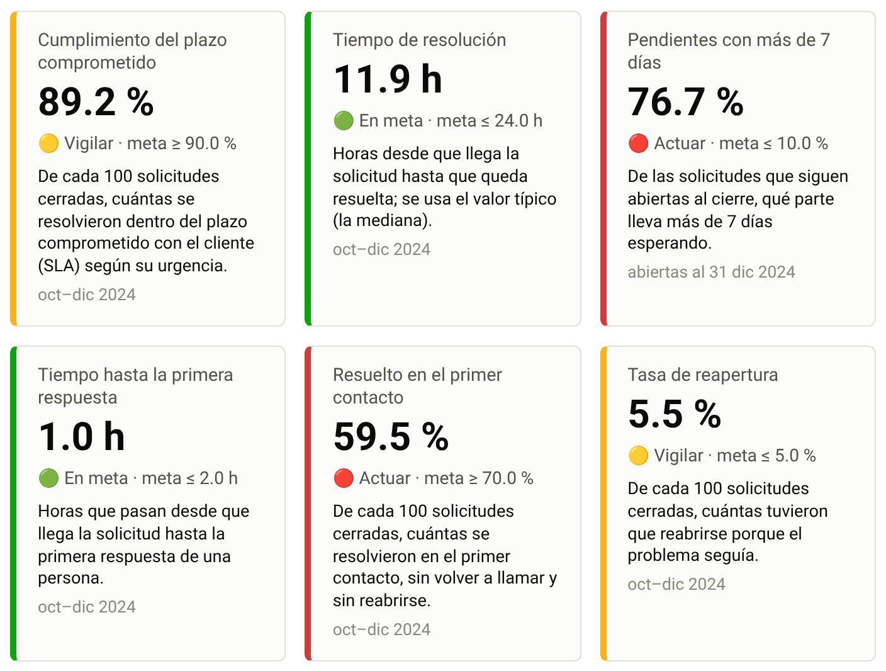
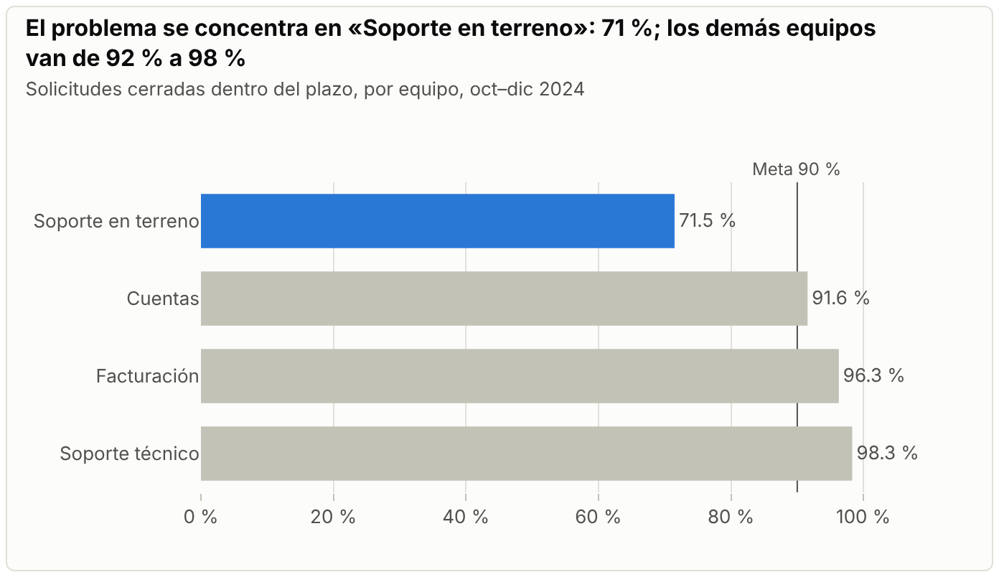
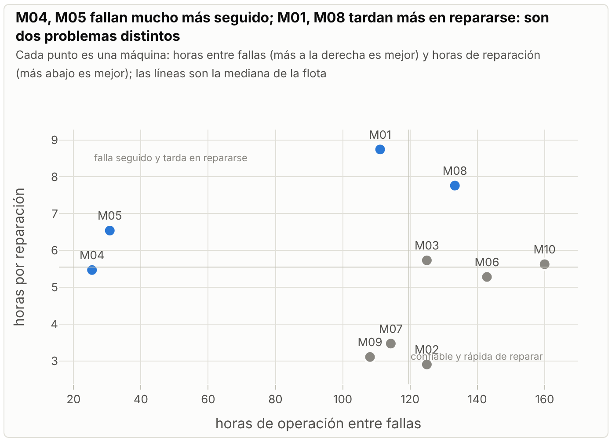
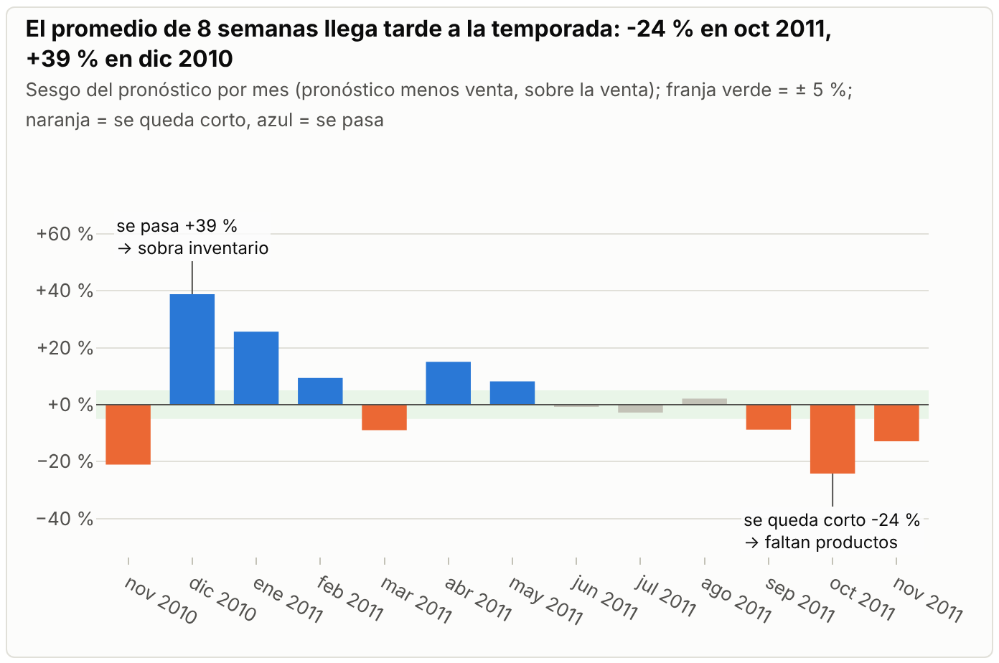
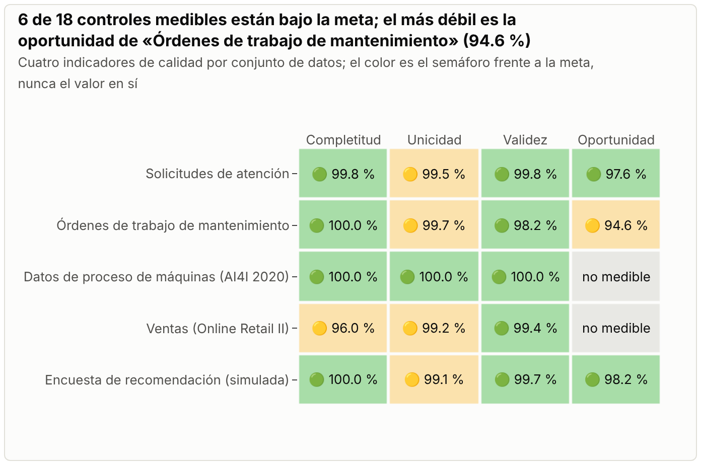
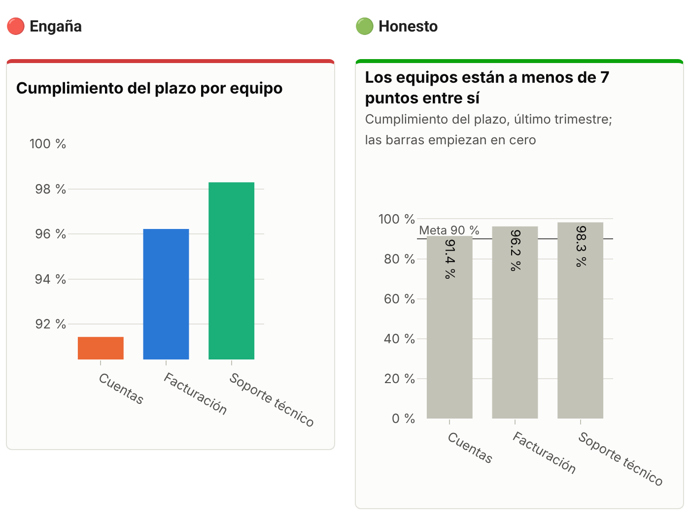
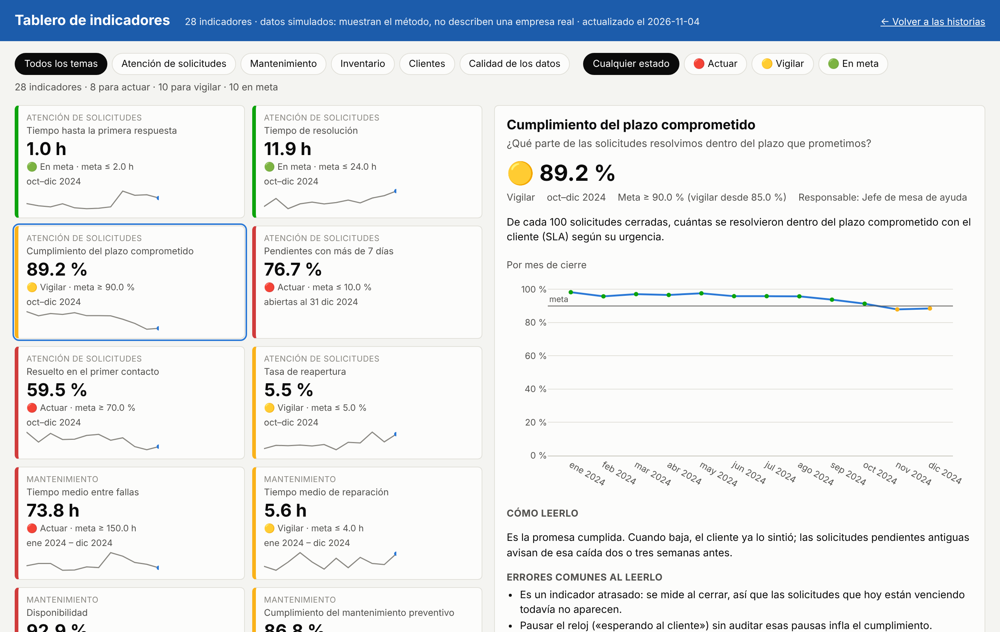

# Indicadores que se entienden

[](https://github.com/juansanchezalcantara20-ai/kpi-catalog-storytelling/actions/workflows/ci.yml)
[](https://github.com/juansanchezalcantara20-ai/kpi-catalog-storytelling/actions/workflows/actualizar-datos.yml)

**Un indicador no depende de la herramienta.** En este proyecto cada indicador se **define una sola vez**
(un catálogo), se **calcula una sola vez** (un motor probado) y se **presenta de dos formas**: historias que explican
qué pasó y qué decidir, y un tablero interactivo para el seguimiento semanal. Todo se construye y se publica en la nube.

**→ Sitio: <https://juansanchezalcantara20-ai.github.io/kpi-catalog-storytelling/>**
**→ Tablero: <https://juansanchezalcantara20-ai.github.io/kpi-catalog-storytelling/dashboard/>**

| | |
|---|---|
| **28 indicadores** en 5 temas | cada uno con la pregunta que responde, qué significa, cómo se calcula en palabras, un ejemplo con números, meta y semáforo, responsable, errores comunes de lectura, qué decisión ayuda a tomar y con qué otro indicador se equilibra |
| **5 casos contados como historia** | en 30 segundos → pregunta → indicadores → lo que encontramos → qué decidimos → cómo lo seguimos midiendo → detalle técnico |
| **Datos reales** | solicitudes ciudadanas de Nueva York (servicio 311) y dos conjuntos públicos del repositorio UCI, descargados cada mes en GitHub Actions |
| **Fórmulas probadas** | un ejemplo calculado a mano por indicador, comprobado contra el cálculo en Python y contra una consulta SQL |
| **Legibilidad probada** | una prueba automática falla si una página tiene palabras técnicas en inglés, siglas sin explicar o código fuera del detalle técnico |

## Recorrido en cinco minutos

**1 · Cada caso empieza con «En 30 segundos»** y con una tarjeta por indicador: valor, meta, semáforo con texto
(🟢 En meta · 🟡 Vigilar · 🔴 Actuar) y qué significa.



**2 · El título de cada gráfico es la conclusión**, calculada desde los datos.



**3 · Separar las causas.** La disponibilidad depende de cada cuánto falla una máquina y de cuánto tarda en volver:
dos problemas distintos, dos decisiones distintas.



**4 · La dirección importa.** El sesgo del pronóstico se evalúa contra una franja: se queda corto antes de la temporada
(faltan productos) y se pasa después (sobra inventario).



**5 · La calidad de los datos se mide como cualquier indicador**, y dice «no se puede medir» cuando falta un dato en
vez de inventar un 100 %.



**6 · Errores comunes al medir:** el mismo dato mostrado de forma engañosa y de forma honesta.



**7 · El tablero** muestra los mismos números que las historias, con filtros por tema y por semáforo.



*Las capturas se tomaron con los datos de respaldo (simulados); el sitio publicado usa los datos reales de cada mes.*

## Los casos

| # | Caso | Indicadores | Datos |
|---|------|------|------|
| 1 | Atención de solicitudes: ¿cumplimos el plazo prometido? | cumplimiento del plazo, tiempo de resolución, pendientes antiguas, primera respuesta, resuelto en el primer contacto, reapertura | **Reales:** NYC 311, Departamento de Transporte, últimos 12 meses |
| 2 | Mantenimiento | disponibilidad, tiempo entre fallas, tiempo de reparación, preventivo a tiempo, trabajo planificado | **Reales:** AI4I 2020 (UCI) + órdenes de trabajo simuladas |
| 3 | Inventario y demanda | unidades atendidas, pedidos completos y a tiempo, quiebres, cobertura, rotación, inventario sin movimiento, error y sesgo del pronóstico | **Reales:** ventas de Online Retail II (UCI) + inventario simulado |
| 4 | Clientes | clientes que vuelven, recompra, ingreso en riesgo, recomendación | **Reales:** Online Retail II (UCI) + encuesta simulada |
| 5 | Calidad de los datos | completitud, unicidad, validez, oportunidad | los datos de los casos 1 a 4 tal como llegan |

Si una descarga falla, ese caso vuelve a datos simulados con semilla fija y **la página lo dice**. Detalle en
[`cases/`](cases/README.md) y en la página *Fuentes de datos* del sitio.

## Cómo actualizar los datos

1. Entra a la pestaña **Actions** del repositorio.
2. Elige **Actualizar datos** en la lista de la izquierda.
3. Pulsa **Run workflow** y confirma.

El proceso descarga los datos públicos, recalcula los indicadores, corre todas las pruebas (fórmulas, legibilidad,
coherencia de cifras y candado de privacidad) y **solo si todo pasa** publica el sitio. También corre solo el día 3 de
cada mes y con cada cambio en la rama principal.

## Cómo está construido

```
kpis/catalog.yaml  ──►  validación (esquema + reglas de coherencia)
        │
        ├─► kpistory.formulas   una función de Python por indicador
        └─► sql: en el catálogo  consulta de referencia, probada en SQLite

config/fuentes.yaml ─► descarga (NYC 311, UCI) o plan B ─► kpistory.engine ─┬─► historias (MkDocs + Plotly)
                                                                              └─► tablero interactivo
                                                     candado de privacidad ──► GitHub Pages
```

- **Una sola fuente de verdad.** La validación falla si un indicador no tiene función de cálculo, si sobra una función,
  si la meta contradice el sentido del indicador o si un parámetro no está declarado.
- **Un solo valor por indicador.** Caso, catálogo y tablero leen el mismo valor de referencia; una prueba lo comprueba.
- **Privacidad.** De NYC 311 solo se descargan número, fechas, tipo, canal, estado y distrito; un control impide publicar
  si aparece un correo, un teléfono, una dirección o un archivo de datos crudos.

Para desarrollar sin instalar nada localmente: **Code → Codespaces → Create codespace** (el entorno está en
`.devcontainer/`). Dentro del Codespace:

```bash
make all SOURCE=synthetic
```

```bash
mkdocs serve
```

## Qué demuestra

| Lo que piden las vacantes | Dónde está |
|---|---|
| **Diseño de indicadores** (control de gestión, planeamiento y control) | `kpis/catalog.yaml`: pregunta, definición, cálculo, meta, semáforo, responsable, errores de lectura, decisión y contrapeso de 28 indicadores |
| **Leer indicadores con criterio** | adelantados frente a atrasados, mediana frente a promedio, unidades frente a pedidos completos, error ponderado frente a promedio, sesgo con franja, recomendación con margen de error, y la revisión de la aparente contradicción del caso 1 |
| **Contar historias con datos** | cinco casos con la misma estructura; títulos que son conclusiones; decisiones con responsable y fecha |
| **Diseño de tableros** | tarjetas con semáforo y texto, paleta apta para daltonismo, un mensaje por gráfico, meta siempre visible, tablero interactivo con filtros |
| **SQL** | consulta de referencia para 23 indicadores, probada contra los ejemplos calculados a mano |
| **Datos reales y automatización** | descarga paginada con reintentos y mínimo de filas, actualización mensual en GitHub Actions, plan B con aviso |
| **Calidad y gobierno de datos** | cuatro dimensiones de calidad como indicadores, reglas por conjunto de datos y candado de privacidad |
| **Excelencia operacional y mejora continua** | capacidad y pendientes (atención), mantenimiento por condición y repuestos (mantenimiento), pronóstico de temporada (inventario), lista de recuperación (clientes) |

## Cómo se hizo

Diseñé y dirigí el proyecto; el código y los textos los escribió **Claude Code** (el agente de programación de
Anthropic) siguiendo mis indicaciones: qué medir, la lista de casos, la estructura de cada historia, las reglas de
los gráficos, las reglas de honestidad y las etapas. Todas las decisiones y sus motivos están en
[`docs/DECISIONS.md`](docs/DECISIONS.md), incluidos los lugares donde una primera versión estaba mal y cómo se corrigió.

## Alcance y límites

- **Datos.** Solo datos públicos o simulados. Ningún dato, nombre, cifra ni caso de empleadores o clientes reales.
- **Lo simulado es método, no evidencia.** Las órdenes de trabajo, el inventario, el pronóstico, las entregas y la
  encuesta son simulaciones con reglas explícitas; lo que muestran ilustra el método, no describe una operación real.
- **Supuestos propios.** La prioridad y el plazo de cada tipo de reclamo de NYC 311 son un supuesto de este proyecto,
  no una regla de la ciudad. NYC 311 no registra primera respuesta, contactos ni reaperturas: esos indicadores
  aparecen «Sin dato» con datos reales.
- **Metas ilustrativas**, elegidas para que el semáforo tenga sentido con estos datos.
- **Fuera de alcance:** costo o margen por orden de trabajo (se dejó fuera a propósito).

## Mapa del repositorio

```
kpis/                catálogo de indicadores, su esquema y las reglas de calidad de datos
config/              fuentes públicas: dirección, filtros, periodo y supuestos
src/kpistory/        motor, fórmulas, datos, gráficos, sitio, tablero y candado de privacidad
tests/               ejemplos calculados a mano y pruebas de fórmulas, SQL, datos, fuentes, legibilidad y coherencia
cases/               un README por caso: fuente, plan B, semilla y supuestos
docs/                páginas fijas del sitio, registro de decisiones y capturas
.devcontainer/       entorno de GitHub Codespaces
.github/workflows/   CI (cada cambio) y Actualizar datos (mensual, manual y en cada cambio de la rama principal)
```

Licencia MIT. Autor: Juan Luis Sánchez Alcántara.
