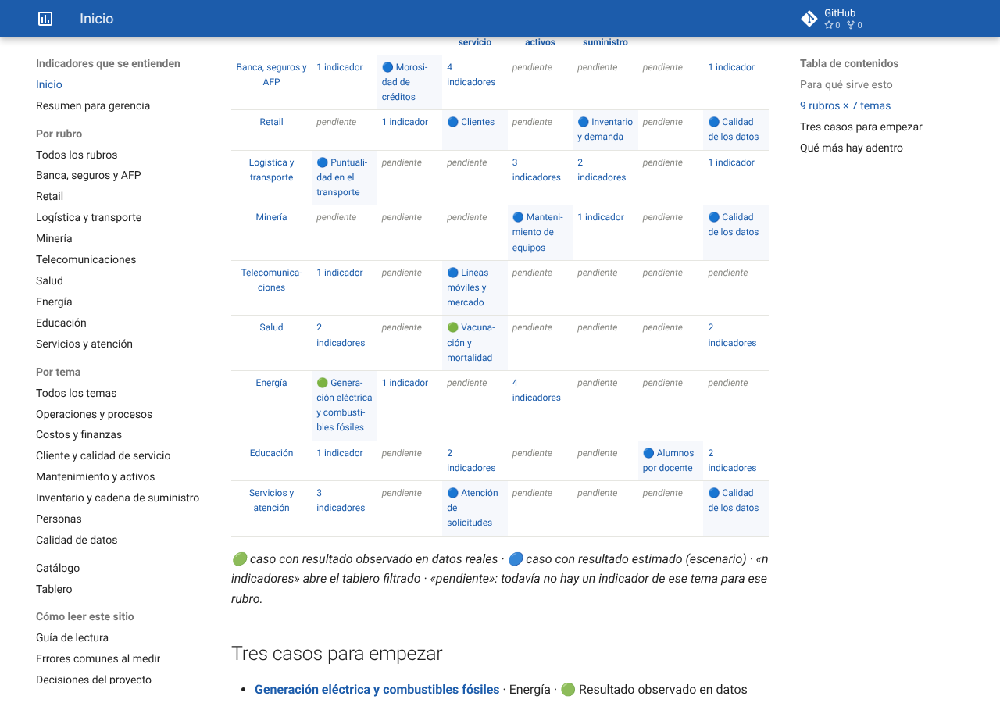
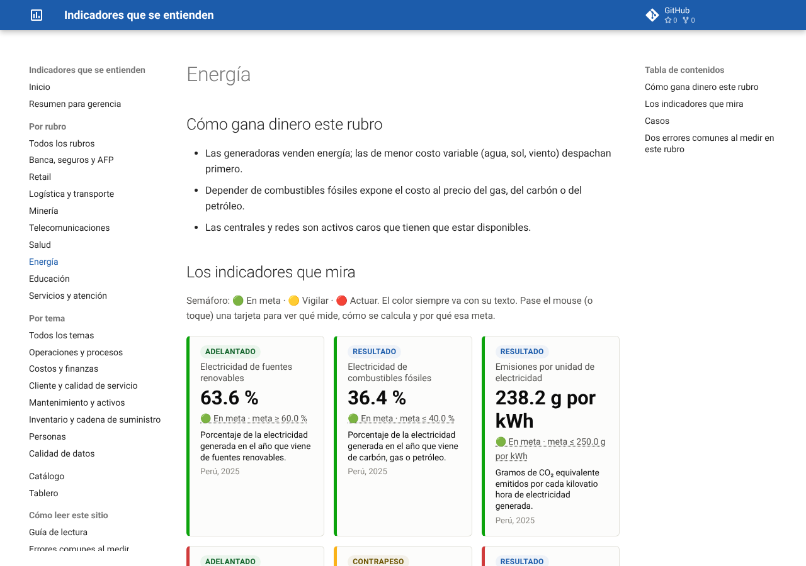
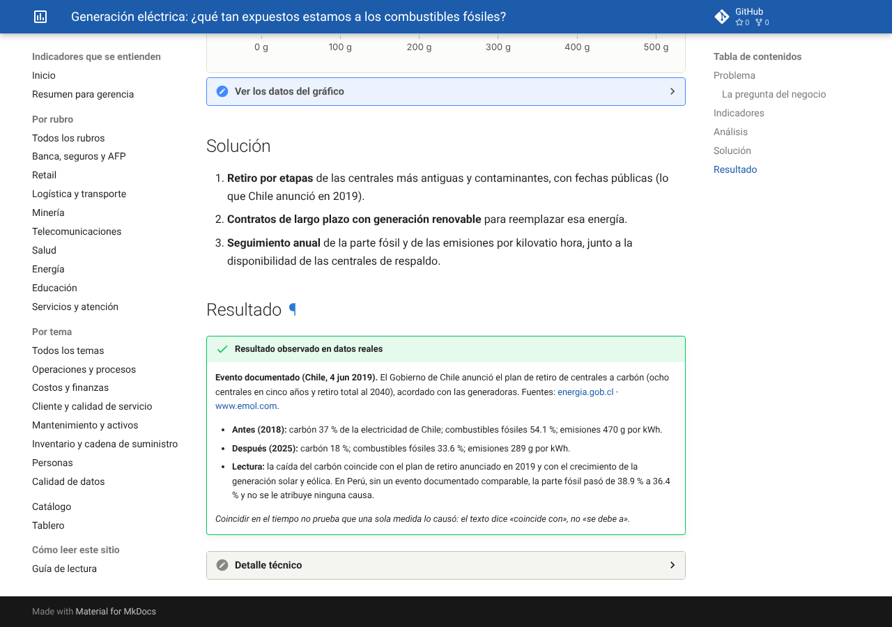
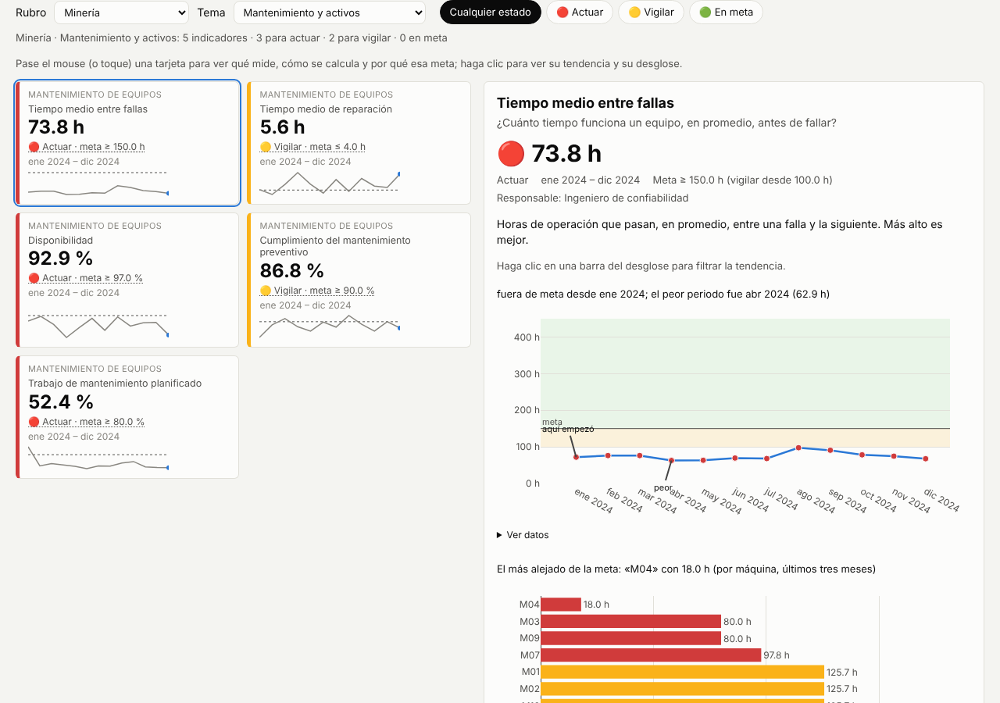
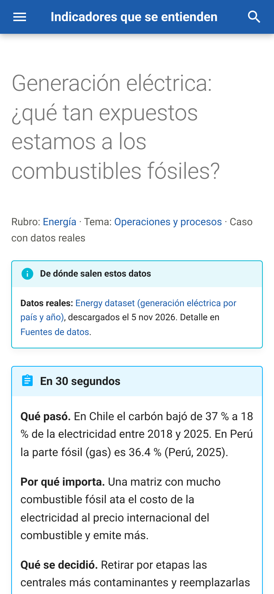
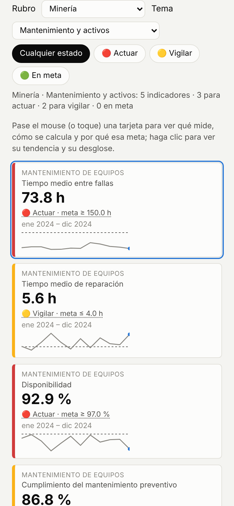

# Indicadores que se entienden

[](https://github.com/juansanchezalcantara20-ai/kpi-catalog-storytelling/actions/workflows/ci.yml)
[](https://github.com/juansanchezalcantara20-ai/kpi-catalog-storytelling/actions/workflows/actualizar-datos.yml)

**Un indicador no depende de la herramienta.** En este proyecto cada indicador se **define una sola vez**
(un catálogo), se **calcula una sola vez** (un motor probado) y se **presenta de dos formas**: historias que explican
qué pasó y qué decidir, y un tablero interactivo para el seguimiento semanal. Todo se construye y se publica en la nube.

**→ Sitio: <https://juansanchezalcantara20-ai.github.io/kpi-catalog-storytelling/>**
**→ Tablero: <https://juansanchezalcantara20-ai.github.io/kpi-catalog-storytelling/dashboard/>**

| | |
|---|---|
| **9 rubros × 7 temas** | banca, retail, logística, minería, telecomunicaciones, salud, energía, educación y servicios; operaciones, costos, cliente, mantenimiento, inventario, personas y calidad de datos |
| **39 indicadores** | cada uno con su tema, los rubros donde sirve, la pregunta que responde, cómo se calcula en palabras, un ejemplo con números, meta (y metas por rubro), semáforo, responsable, errores de lectura, decisión y contrapeso |
| **11 casos «Problema → Solución → Resultado»** | en 30 segundos → problema → indicadores (resultado, adelantados, contrapeso) → análisis → solución → resultado → detalle técnico |
| **Resultados honestos** | «observado en datos reales» solo con un evento documentado y su fuente; si no, «estimado (escenario)» |
| **Datos públicos reales** | NYC 311, UCI, Our World in Data, UNESCO, UIT y la Oficina de Estadísticas de Transporte de EE. UU., descargados cada mes en GitHub Actions |
| **Fórmulas probadas** | un ejemplo calculado a mano por indicador, comprobado contra el cálculo en Python y, en 30 indicadores, contra una consulta SQL |
| **Legibilidad probada** | una prueba falla si una página tiene palabras técnicas en inglés, siglas sin explicar o código fuera del detalle técnico |

## Los rubros y sus fuentes

| Rubro | Fuente | Casos | Tipo de resultado |
|---|---|---|---|
| Banca, seguros y AFP | **simulado** (no hay fuente pública estable sin registro) | Morosidad de créditos | estimado |
| Retail | Online Retail II (UCI, CC BY 4.0) + inventario y encuesta simulados | Inventario y demanda · Clientes · Calidad de los datos | estimado |
| Logística y transporte | Oficina de Estadísticas de Transporte de EE. UU., muestra de 200 000 vuelos (vega-datasets) | Puntualidad en el transporte | estimado |
| Minería | AI4I 2020 (UCI): conjunto de referencia, **sintético según su publicador** + órdenes simuladas | Mantenimiento de equipos · Calidad de los datos | estimado |
| Telecomunicaciones | UIT vía Our World in Data (TidyTuesday) | Líneas móviles y mercado | estimado |
| Salud | Our World in Data, vacunación y muertes por COVID-19 (CC BY 4.0) | Vacunación y mortalidad | **observado** (inicio de la vacunación en Perú, 9 feb 2021) |
| Energía | Our World in Data, generación eléctrica (CC BY 4.0) | Generación eléctrica y combustibles fósiles | **observado** (plan de retiro del carbón en Chile, 4 jun 2019) |
| Educación | Instituto de Estadística de la UNESCO (TidyTuesday) | Alumnos por docente | estimado |
| Servicios y atención | NYC 311, Departamento de Transporte | Atención de solicitudes · Calidad de los datos | estimado |

Los casos comparan **grupos** (países, regiones, niveles educativos, tipos de entidad, franjas horarias), nunca empresas
con nombre. Si una descarga falla, el caso usa su plan B simulado, **lo dice** y su resultado pasa a «estimado».

## Recorrido en cinco minutos

**1 · La portada** dice cuántos casos tienen resultado observado y cuántos estimado, y muestra la matriz rubro × tema:
cada celda abre un caso, el tablero filtrado o dice «pendiente».



**2 · Cada rubro** explica en tres líneas cómo gana dinero, muestra de 6 a 8 indicadores como mini tablero, sus casos,
dos errores comunes al medir y un botón al tablero ya filtrado.



**3 · Cada caso** termina en un resultado etiquetado. Este es observado: enlaza el evento documentado y dice «coincide
con», no «se debe a».



**4 · El tablero** se filtra por rubro y tema a la vez, y la dirección guarda el filtro
(`#/rubro/mineria/tema/mantenimiento`), así que se puede compartir.



**5 · En el celular** todo cabe sin desplazarse de lado, y el tooltip se abre completo con un toque.

 

*Las capturas usan los datos sectoriales reales y, para NYC 311 y UCI, los datos de respaldo (simulados), porque esas
direcciones no responden desde el entorno de desarrollo; el sitio publicado usa los datos reales de cada mes.*

## El valor en soles

Los cinco casos con supuestos de costo defendibles traducen su brecha a soles y horas con `config/supuestos_valor.yaml`
(todos ilustrativos y editables en la web). En los demás rubros la alerta muestra el indicador fuera de meta **sin
inventar un costo**. El «Resumen para gerencia» tiene un selector de rubro con sus alertas más caras.

| Caso | Qué se cuesta | Supuesto principal |
|---|---|---|
| Atención de solicitudes | pendientes con más de 7 días y solicitudes fuera de plazo | S/ 60 al mes por pendiente antigua; S/ 45 por solicitud fuera de plazo |
| Mantenimiento | horas de máquina parada por encima de la meta | S/ 450 por hora parada |
| Inventario | pedidos incompletos o tardíos e inventario sin movimiento | S/ 25 por pedido con problema; 25 % al año por mantener inventario |
| Clientes | ingreso de clientes en riesgo | se pierde un margen de 30 % de lo que compraban |
| Calidad de los datos | registros de venta con datos faltantes | S/ 4 (6 minutos) por registro corregido |

## Cómo actualizar los datos

1. Entra a la pestaña **Actions** del repositorio.
2. Elige **Actualizar datos** en la lista de la izquierda.
3. Pulsa **Run workflow** y confirma.

El proceso descarga los datos públicos, recalcula los indicadores, corre todas las pruebas (fórmulas, legibilidad,
coherencia de cifras y candado de privacidad) y **solo si todo pasa** publica el sitio. También corre solo el día 3 de
cada mes y con cada cambio en la rama principal.

## Cómo está construido

```
kpis/catalog.yaml  ──►  validación (esquema + reglas de coherencia)
        │
        ├─► kpistory.formulas   una función de Python por indicador
        └─► sql: en el catálogo  consulta de referencia, probada en SQLite

config/fuentes.yaml ─► descarga (7 fuentes públicas) o plan B ─► kpistory.engine ─┬─► casos, rubros y temas (MkDocs + Plotly)
                                                                              └─► tablero interactivo
                                                     candado de privacidad ──► GitHub Pages
```

- **Una sola fuente de verdad.** La validación falla si un indicador no tiene función de cálculo, si sobra una función,
  si la meta contradice el sentido del indicador o si un parámetro no está declarado.
- **Un solo valor por indicador.** Caso, catálogo y tablero leen el mismo valor de referencia; una prueba lo comprueba.
- **Dos ejes.** `config/rubros.yaml` define rubros y temas; el catálogo asigna a cada indicador su tema y sus rubros, y
  la validación falla si un rubro no tiene caso o si un resultado «observado» no tiene evento con fuente.
- **Privacidad.** De NYC 311 solo se descargan número, fechas, tipo, canal, estado y distrito; un control impide publicar
  si aparece un correo, un teléfono, una dirección o un archivo de datos crudos, y una prueba revisa que ninguna tabla
  publicada tenga columnas de datos personales.

Para desarrollar sin instalar nada localmente: **Code → Codespaces → Create codespace** (el entorno está en
`.devcontainer/`). Dentro del Codespace:

```bash
make all SOURCE=synthetic
```

```bash
mkdocs serve
```

Revisión visual (capturas en escritorio y celular, sin scroll horizontal y con tooltips completos):

```bash
NODE_PATH=$(npm root -g) node tools/revision_visual.js
```

## Qué demuestra

| Capacidad | Dónde está |
|---|---|
| **Diseño de indicadores** (control de gestión, planeamiento y control) | `kpis/catalog.yaml`: 39 indicadores con tema, rubros, metas por rubro, decisión y contrapeso |
| **Conocer el negocio de cada sector** | `config/rubros.yaml`: cómo gana dinero cada rubro y dos errores comunes al medirlo |
| **Leer indicadores con criterio** | adelantados frente a resultados, mediana frente a promedio, ponderar por tamaño, «coincide con» frente a «se debe a» |
| **Contar historias con datos** | once casos con la misma plantilla «Problema → Solución → Resultado»; títulos que son conclusiones |
| **Diseño de tableros** | filtros combinables por rubro y tema con dirección compartible, semáforo, tooltip, desglose con drill-down |
| **Traducir indicadores a dinero** | brecha → unidades → soles y horas, simulador «¿y si…?», alertas más caras por rubro |
| **SQL** | consulta de referencia para 30 indicadores, probada contra los ejemplos calculados a mano |
| **Datos reales y automatización** | siete fuentes públicas sin clave, mínimo de filas, plan B con aviso, actualización mensual en GitHub Actions |
| **Calidad, gobierno de datos y privacidad** | cuatro dimensiones de calidad como indicadores, candado de privacidad y prueba de columnas personales |

## Cómo se hizo

Diseñé y dirigí el proyecto; el código y los textos los escribió **Claude Code** (el agente de programación de
Anthropic) siguiendo mis indicaciones: qué medir, la lista de casos, la estructura de cada historia, las reglas de
los gráficos, las reglas de honestidad y las etapas. Todas las decisiones y sus motivos están en
[`docs/DECISIONS.md`](docs/DECISIONS.md), incluidos los lugares donde una primera versión estaba mal y cómo se corrigió.

## Alcance y límites

- **Datos.** Solo datos públicos o simulados. Ningún dato, nombre, cifra ni caso de empleadores o clientes reales.
- **Lo simulado es método, no evidencia.** Las órdenes de trabajo, el inventario, el pronóstico, las entregas y la
  encuesta son simulaciones con reglas explícitas; lo que muestran ilustra el método, no describe una operación real.
- **Resultados observados con cautela.** Los dos resultados observados (Chile y el carbón; Perú y la vacunación)
  coinciden en el tiempo con un evento documentado; los datos no prueban que esa sola medida los causó.
- **Rubros sin fuente real.** Banca usa una cartera simulada; minería usa AI4I, que su publicador describe como
  sintético. Las series del Banco Central de Reserva del Perú quedaron como candidatas (ver *Fuentes*).
- **Supuestos propios.** La prioridad y el plazo de cada tipo de reclamo de NYC 311 son un supuesto de este proyecto,
  no una regla de la ciudad. NYC 311 no registra primera respuesta, contactos ni reaperturas: esos indicadores
  aparecen «Sin dato» con datos reales.
- **Metas ilustrativas**, elegidas para que el semáforo tenga sentido con estos datos.
- **Fuera de alcance:** costo o margen por orden de trabajo (se dejó fuera a propósito).

## Mapa del repositorio

```
kpis/                catálogo de indicadores, su esquema y las reglas de calidad de datos
config/              rubros y temas, fuentes públicas (dirección, licencia, filtros) y supuestos de valor en soles
src/kpistory/        motor, fórmulas, datos, gráficos, sitio, tablero y candado de privacidad
tests/               ejemplos calculados a mano y pruebas de fórmulas, SQL, datos, fuentes, legibilidad, coherencia, valor y gráficos
tools/               revisión visual con Playwright
includes/            glosario de siglas que el sitio muestra al pasar el mouse
cases/               resumen de los casos y un README por cada caso con simulador
docs/                páginas fijas del sitio, registro de decisiones y capturas (docs/capturas)
.devcontainer/       entorno de GitHub Codespaces
.github/workflows/   CI (cada cambio) y Actualizar datos (mensual, manual y en cada cambio de la rama principal)
```

Licencia MIT. Autor: Juan Luis Sánchez Alcántara.
