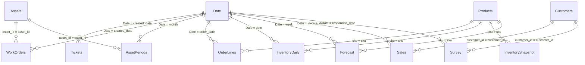

<!-- GENERATED FROM src/kpistory/powerbi/export.py by `kpistory powerbi` - do not edit by hand. -->
# Power BI semantic model (star schema)

The model the measures in `measures.dax` expect. Fact tables keep the grain of the Python tables, so a measure filtered by the same rows returns the same number as the engine. All tables are exported to `powerbi/data/*.csv` by `make data powerbi`.

## Diagram

## Tables

| Table | Role | Grain | Columns |
|---|---|---|---|
| Date | dimension | one row per day | Date (date), Year, Quarter, Year-Quarter, Month, Year-Month, Week start |
| Tickets | fact | one row per ticket | ticket_id (text), created_at (datetime), created_date (date), priority (text), queue (text), channel (text), status (text), first_response_hours (decimal), resolution_hours (decimal), sla_target_hours (decimal), within_sla (boolean), age_days (decimal), contacts (integer), reopened (boolean) |
| WorkOrders | fact | one row per work order | wo_id (text), asset_id (text), wo_type (text), planned (boolean), created_date (date), due_date (date), completed_at (datetime), repair_hours (decimal), labor_hours (decimal), failure_label (text), pm_on_time (boolean) |
| AssetPeriods | fact | one row per machine and month | asset_id (text), month (date), operating_hours (decimal), scheduled_hours (decimal), unplanned_downtime_hours (decimal), failures (integer) |
| OrderLines | fact | one row per order line | order_id (text), sku (text), order_date (date), promised_date (date), delivered_date (date), qty_ordered (integer), qty_shipped (integer) |
| InventoryDaily | fact | one row per SKU and day | date (date), sku (text), on_hand_units (decimal), on_hand_value (decimal), demand_units (decimal), shipped_units (decimal), cogs_value (decimal), active (boolean) |
| InventorySnapshot | fact | one row per SKU at the last date | sku (text), sku_group (text), on_hand_units (decimal), on_hand_value (decimal), days_since_last_movement (integer) |
| Forecast | fact | one row per SKU and week | sku (text), week (date), actual_units (decimal), forecast_units (decimal) |
| Sales | fact | one row per invoice line of an identified customer | invoice_id (text), invoice_date (date), customer_id (text), sku (text), quantity (integer), unit_price (decimal), revenue (decimal), country (text) |
| Survey | fact | one row per NPS response | response_id (text), customer_id (text), score (integer), responded_date (date) |
| DQResults | fact | one row per dataset and data-quality dimension | dataset (text), label (text), dimension (text), passed (integer), total (integer) |
| Customers | dimension | one row per customer (RFM at the last date) | customer_id (text), rfm_segment (text), recency_days (integer), frequency (integer), monetary (decimal), r (integer), f (integer), m (integer) |
| Assets | dimension | one row per machine | asset_id (text) |
| Products | dimension | one row per simulated SKU | sku (text), sku_group (text) |

## Relationships

All one-to-many, single direction (dimension filters fact), active.

| From (one) | To (many) |
|---|---|
| Date[Date] | Tickets[created_date] |
| Date[Date] | WorkOrders[created_date] |
| Date[Date] | AssetPeriods[month] |
| Date[Date] | OrderLines[order_date] |
| Date[Date] | InventoryDaily[date] |
| Date[Date] | Forecast[week] |
| Date[Date] | Sales[invoice_date] |
| Date[Date] | Survey[responded_date] |
| Customers[customer_id] | Sales[customer_id] |
| Customers[customer_id] | Survey[customer_id] |
| Assets[asset_id] | WorkOrders[asset_id] |
| Assets[asset_id] | AssetPeriods[asset_id] |
| Products[sku] | OrderLines[sku] |
| Products[sku] | InventoryDaily[sku] |
| Products[sku] | InventorySnapshot[sku] |
| Products[sku] | Forecast[sku] |

## Measures by home table

| Measure | Home table | Format string | Target |
|---|---|---|---|
| First response time median | Tickets | `0.0 "h"` | ≤ 2.0 h (amber ≤ 4.0 h) |
| Resolution time median | Tickets | `0.0 "h"` | ≤ 24.0 h (amber ≤ 36.0 h) |
| SLA compliance | Tickets | `0.0%` | ≥ 90.0% (amber ≥ 85.0%) |
| Aged backlog 7 days | Tickets | `0.0%` | ≤ 10.0% (amber ≤ 20.0%) |
| First contact resolution FCR | Tickets | `0.0%` | ≥ 70.0% (amber ≥ 60.0%) |
| Reopen rate | Tickets | `0.0%` | ≤ 5.0% (amber ≤ 8.0%) |
| Mean time between failures MTBF | AssetPeriods | `0.0 "h"` | ≥ 150.0 h (amber ≥ 100.0 h) |
| Mean time to repair MTTR | WorkOrders | `0.0 "h"` | ≤ 4.0 h (amber ≤ 6.0 h) |
| Availability | AssetPeriods | `0.0%` | ≥ 97.0% (amber ≥ 95.0%) |
| Preventive maintenance compliance | WorkOrders | `0.0%` | ≥ 90.0% (amber ≥ 80.0%) |
| Planned maintenance share | WorkOrders | `0.0%` | ≥ 80.0% (amber ≥ 65.0%) |
| Fill rate units | OrderLines | `0.0%` | ≥ 95.0% (amber ≥ 90.0%) |
| On time in full OTIF | OrderLines | `0.0%` | ≥ 90.0% (amber ≥ 80.0%) |
| Inventory turnover | InventoryDaily | `0.0"x"` | ≥ 8.0x / year (amber ≥ 5.0x / year) |
| Days of cover | InventoryDaily | `0.0 "d"` | 14.0 days to 35.0 days (amber 7.0 days to 60.0 days) |
| Stockout rate SKU-days | InventoryDaily | `0.0%` | ≤ 3.0% (amber ≤ 6.0%) |
| Obsolete stock share | InventorySnapshot | `0.0%` | ≤ 5.0% (amber ≤ 10.0%) |
| Forecast error MAPE | Forecast | `0.0%` | ≤ 40.0% (amber ≤ 60.0%) |
| Forecast error WAPE | Forecast | `0.0%` | ≤ 30.0% (amber ≤ 45.0%) |
| Forecast bias | Forecast | `0.0%` | -5.0% to 5.0% (amber -10.0% to 10.0%) |
| Customer retention quarter over quarter | Sales | `0.0%` | ≥ 50.0% (amber ≥ 40.0%) |
| Repeat purchase rate | Sales | `0.0%` | ≥ 60.0% (amber ≥ 50.0%) |
| Revenue at risk RFM At risk | Sales | `0.0%` | ≤ 10.0% (amber ≤ 20.0%) |
| Net Promoter Score simulated survey | Survey | `+0;-0;0` | ≥ +30 (amber ≥ +10) |
| Completeness | DQResults | `0.0%` | ≥ 99.0% (amber ≥ 95.0%) |
| Uniqueness | DQResults | `0.0%` | ≥ 99.9% (amber ≥ 99.0%) |
| Validity | DQResults | `0.0%` | ≥ 98.0% (amber ≥ 95.0%) |
| Timeliness | DQResults | `0.0%` | ≥ 95.0% (amber ≥ 90.0%) |

## Notes

- `Sales` holds identified customers only (the same rows as the Python `customer_sales` table); guest checkouts are measured in the data-quality case.
- `within_sla`, `pm_on_time` and `active` are computed in Python with the catalog parameters and exported as columns, so the rule is written once.
- Mark `Date` as a date table (Table tools > Mark as date table) - the retention measure uses `DATEADD`.
